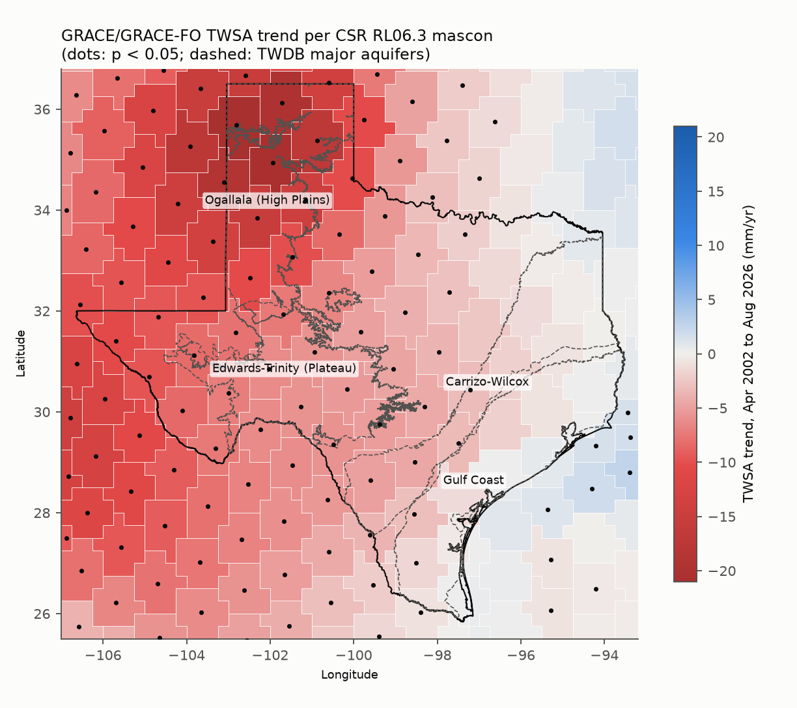
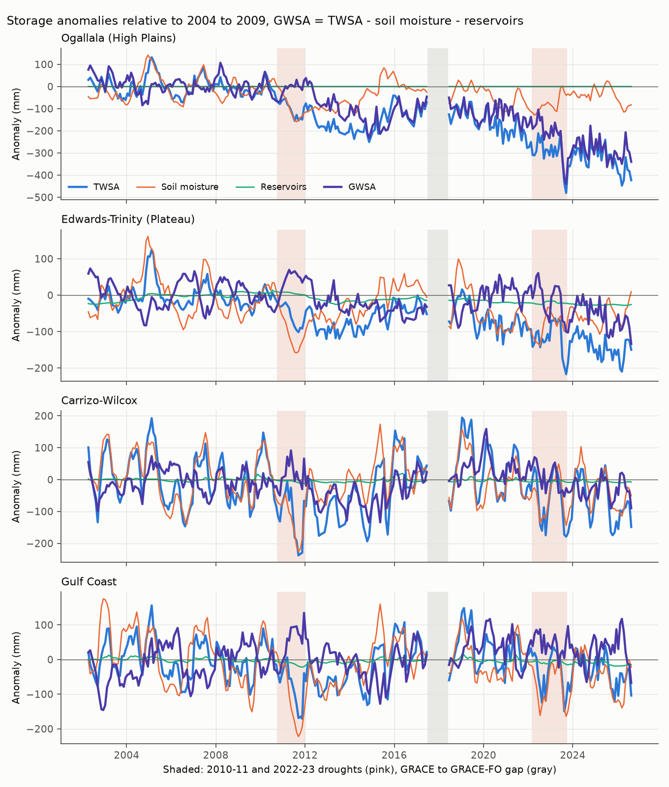
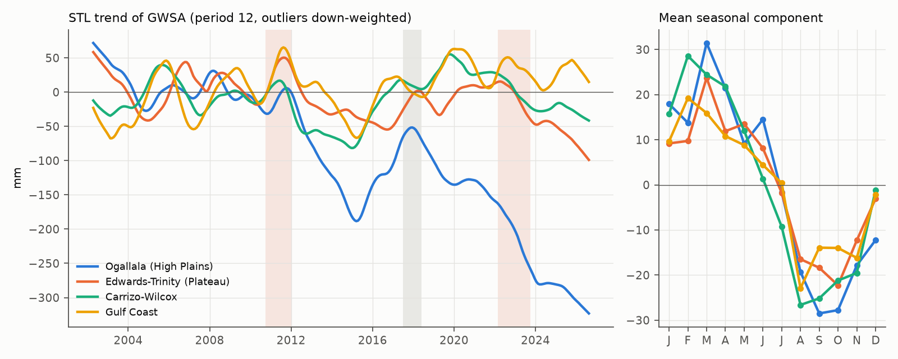
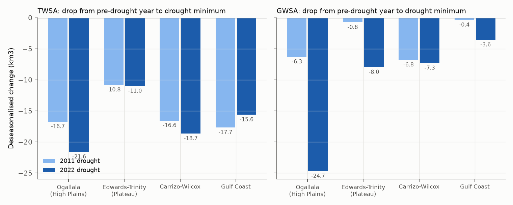
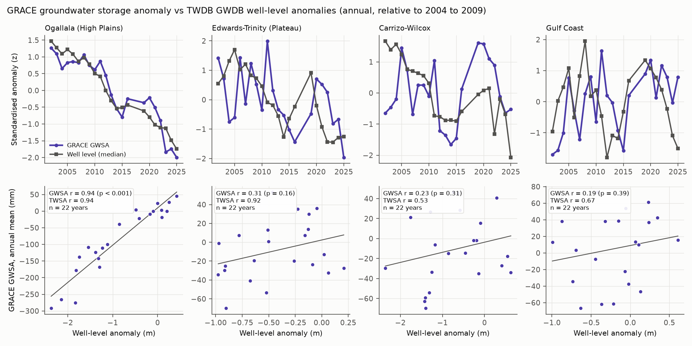
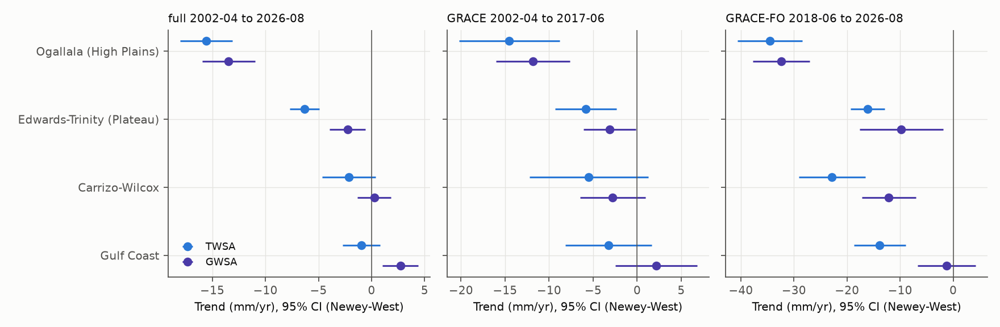
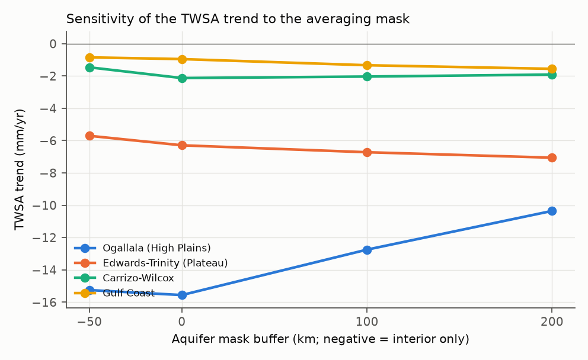
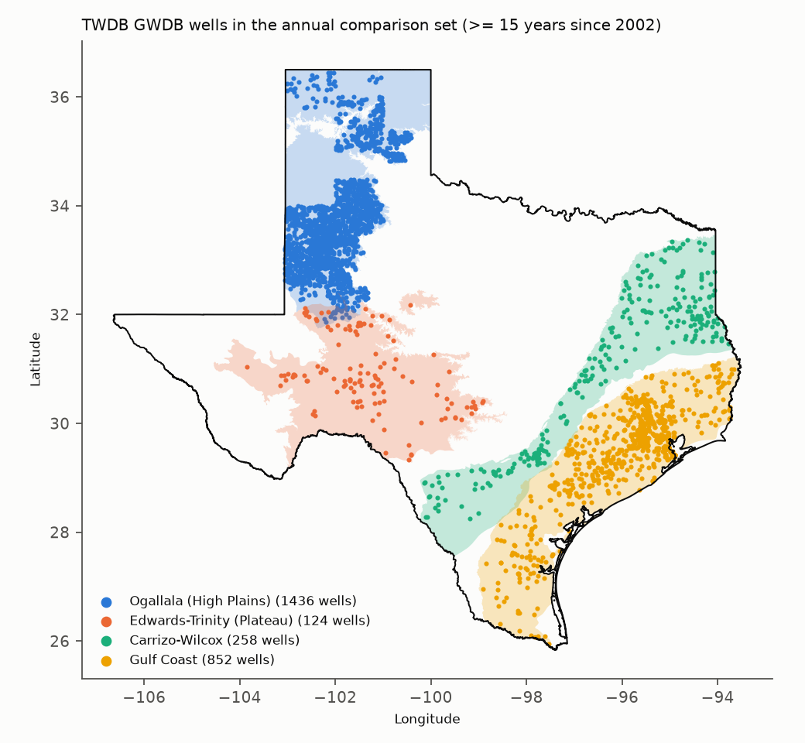

# Groundwater Storage Change in Texas Major Aquifers from GRACE and GRACE-FO, 2002 to 2026

**Author:** Anamika Dristi, Ph.D.

This project estimates groundwater storage change in four Texas major aquifers: the Ogallala (High Plains), Edwards-Trinity (Plateau), Carrizo-Wilcox and Gulf Coast. It uses satellite gravimetry from GRACE and GRACE-FO, April 2002 to August 2026 (260 monthly solutions). Terrestrial water storage anomalies (TWSA) from the UT Austin Center for Space Research (CSR) RL06.3 mascons are averaged over each aquifer. Soil moisture from the NOAA CPC land model and reservoir storage from Water Data for Texas are subtracted to give a groundwater storage anomaly (GWSA). The GWSA is then checked against 465,064 screened water-level measurements from the TWDB Groundwater Database.

The Ogallala shows a clear decline. GWSA fell by 13.5 mm/yr (95% CI 11.0 to 16.0), which is 1.27 km3/yr over the 93,983 km2 Texas part of the aquifer. The decline was faster in the GRACE-FO period (32.4 mm/yr, 2018 to 2026). The GWSA tracks the median well-level decline of 0.116 m/yr closely: annual r = 0.94 across 22 years and about 1,200 wells per year. The implied storage coefficient of about 0.11 is a reasonable specific yield for the Ogallala. The Edwards-Trinity (Plateau) GWSA declined by 2.3 mm/yr. The Carrizo-Wilcox and Gulf Coast GWSA trends are not distinguishable from zero, or are slightly positive, and they correlate weakly with wells. For those two aquifers the soil moisture subtraction and the coarse GRACE footprint limit what can be said. In the 2011 and 2022 droughts, TWSA dropped by 11 to 22 km3 in every aquifer.

This is an independent analysis of public data. It is separate from my LSU dissertation datasets and uses none of them.

## Why it matters

- **Water supply in a drought-prone state.** More than half of the water used in Texas comes from groundwater, and the Ogallala supplies most irrigation in the High Plains. Storage change at aquifer scale is what regional water planning groups and groundwater conservation districts need, and wells alone sample it unevenly.
- **Remote sensing and GIS work.** The workflow combines a satellite gravimetry product, a land surface model, reservoir records and in-situ wells. It includes area-weighted zonal statistics in an equal-area projection, trend and decomposition statistics, and an explicit check of resolution and leakage. These are the skills used in environmental scientist, hydrologist and remote sensing analyst roles at state agencies (TWDB, TCEQ), USGS water science centers, consulting firms and university groups in Texas and Louisiana.
- **Link to my research area.** My dissertation work is on how water and carbon move through river and estuary systems, where storage and drought shape fluxes. See, for context, Dristi & Xu 2023 (Water 15(14):2621), Dristi & Xu 2025 (Water 17(17):2589) and Dristi et al. 2025 (Estuarine, Coastal and Shelf Science 324:109465). This project uses none of those data.

## Data sources

All sources are public and keyless. All were accessed on 2026-10-23.

| Dataset | Provider and link | Version and records | Use |
|---|---|---|---|
| GRACE/GRACE-FO RL06.3 mascons, `CSR_GRACE_GRACE-FO_RL0603_Mascons_all-corrections.nc`, plus `..._RL06_Mascons_v02_LandMask.nc` and `..._RL0603_mascons_mapping_file.nc` | UT Austin Center for Space Research, https://download.csr.utexas.edu/outgoing/grace/RL0603_mascons/ (DOI 10.15781/cgq9-nh24) | File created 2026-10-07. 260 monthly solutions, 2002-04 to 2026-08, 33 months missing (see `outputs/tables/grace_missing_months.csv`), 0.25 degree grid of 1 degree equal-area mascons. GIA (ICE6G-D), TN-14 C20/C30 and TN-13 degree-1 corrections are already applied. Anomaly relative to 2004.0 to 2009.999. | TWSA |
| CPC Monthly Soil Moisture v2, `soilw.mon.mean.v2.nc` | NOAA PSL, https://downloads.psl.noaa.gov/Datasets/cpcsoil/ (product page https://psl.noaa.gov/data/gridded/data.cpcsoil.html) | 945 months, 1948-01 to 2026-09, 0.5 degree, one 1.6 m soil column (mm). Texas box kept. | Soil moisture anomaly |
| Reservoir storage, `statewide.csv`, `recent-conditions.geojson` and 122 individual reservoir CSVs (`/reservoirs/individual/<name>.csv`) | TWDB Water Data for Texas, https://www.waterdatafortexas.org/reservoirs/statewide | Daily `reservoir_storage` (acre-feet) for the 122 major reservoirs. 117 have records starting by January 2004. | Reservoir storage anomaly |
| Groundwater Database bulk download, `GWDBDownload.zip` (`WaterLevelsMajor.txt`, `WellMain.txt`) | TWDB, https://www.twdb.texas.gov/groundwater/data/GWDBDownload.zip | Files dated 2026-10-22. 1,751,819 major-aquifer water-level records, of which 465,064 were used after screening (2002 onward, four aquifers). | Well-level validation |
| Major aquifers, `major_aquifers.zip` (`NEW_major_aquifers_dd.shp`) | TWDB GIS data, https://www.twdb.texas.gov/mapping/gisdata/doc/major_aquifers.zip | Outcrop (code 1) plus subsurface (code 2) polygons, dissolved per aquifer. | Aquifer regions |
| 2023 cartographic boundary states, 1:500,000 | U.S. Census Bureau, https://www2.census.gov/geo/tiger/GENZ2023/shp/cb_2023_us_state_500k.zip | Texas outline. | Clip and maps |

**Sources checked and not used:**

- **NASA GLDAS (GES DISC).** Both the HTTPS data URL and OPeNDAP redirect to an Earthdata login (urs.earthdata.nasa.gov) or return HTTP 410, so GLDAS was not used.
- **NLDAS and JPL PO.DAAC mascons.** Both are on Earthdata and need the same login, so they were not used.
- **Replacement for GLDAS.** The NOAA CPC soil moisture model is the keyless land-surface model used instead.
- **Snow water equivalent.** Not subtracted. Snow cover in these aquifers is rare and short-lived, apart from occasional Panhandle snow, so it is small compared with the signals here. This is an assumption, not a measured term.
- **USGS NWIS.** Not queried separately. The TWDB GWDB major-aquifer water-level table already holds 115,178 measurements from 2002 onward made by the USGS.

## Methods

1. **Aquifer regions** (`02_aquifer_regions.py`).
   - The TWDB outcrop and subsurface polygons are dissolved per aquifer and clipped to Texas. Edwards-Trinity means the Edwards-Trinity (Plateau) aquifer. Carrizo-Wilcox is the TWDB "CARRIZO" layer.
   - Each 0.25 degree (GRACE) and 0.5 degree (CPC) grid cell gets the area of its overlap with the aquifer, computed in NAD83 Texas Centric Albers Equal Area (EPSG:3083).
   - Aquifer areas: Gulf Coast 106,185 km2, Carrizo-Wilcox 95,082 km2, Ogallala 93,983 km2, Edwards-Trinity (Plateau) 91,727 km2.
2. **TWSA** (`03_grace_twsa.py`).
   - The mascon value (cm, converted to mm) is averaged over each aquifer with overlap-area weights, using only land cells from the CSR land mask.
   - Each solution's month label comes from the midpoint of its time bounds. The labels match the CSR missing-month list.
   - Each aquifer mean draws on 19 to 28 mascons.
   - For the map, a trend is fitted to each of the 180 mascons in the Texas box. Grid values are constant within a mascon (largest within-mascon SD is 0.00015 mm), so the mascon value is used directly.
3. **Soil moisture and reservoirs** (`04_soil_moisture_reservoirs.py`).
   - CPC soil moisture is averaged in the same way, and its anomaly is taken against the 2004 to 2009 mean, which matches the GRACE baseline.
   - Daily reservoir storage is averaged to months. Reservoirs located inside each aquifer region are summed (16 for Carrizo-Wilcox, 11 for Gulf Coast, 1 for Edwards-Trinity, which is Amistad, and 1 for the Ogallala, which is Palo Duro). The sum is converted to mm over the aquifer area and taken as an anomaly against 2004 to 2009.
   - Five reservoirs with TWDB records starting after January 2004 (Bois d'Arc, Caddo, Cherokee, Gibbons Creek, Striker) are left out rather than assumed empty.
   - As an upper-bound sensitivity, a second version counts all usable reservoirs within 100 km of each aquifer (12 to 57 reservoirs).
   - GWSA = TWSA minus soil moisture anomaly minus reservoir anomaly.
4. **Well levels** (`05_well_levels.py`). TWDB GWDB measurements are kept if they meet all of these conditions:
   - status "Publishable";
   - from 2002 onward;
   - not flagged as pumping or recently pumped;
   - in a well assigned to one of the four aquifers and located inside that aquifer region.

   Water level is minus the depth to water, in metres. Two composites are built from these measurements:
   - **Annual.** Wells with at least 15 years of data in 2002 to 2025 and at least 3 years in 2004 to 2009. Each well's anomaly is taken against its own 2004 to 2009 mean, and the aquifer value is the median across wells. Wells in the set: Ogallala 1,436, Gulf Coast 852, Carrizo-Wilcox 258, Edwards-Trinity 124.
   - **Monthly.** Wells with at least 120 monthly values, mostly recorders: Ogallala 13, Edwards-Trinity 113, Gulf Coast 106, Carrizo-Wilcox 39.
5. **Statistics** (`06_analysis.py`).
   - **Linear trend.** OLS with annual and semiannual harmonics, with Newey-West (HAC, 12 lags) standard errors. It is fitted for the full record, the GRACE period (2002-04 to 2017-06) and the GRACE-FO period (2018-06 to 2026-08).
   - **STL decomposition.** Period 12, with iterative down-weighting of outliers, on the monthly series, after linear interpolation of the 33 missing months, including the 11-month mission gap.
   - **Drought response.** The deseasonalised anomaly (observed minus the STL seasonal part) is compared between the year before each drought (2010, 2021) and the lowest month in the drought window (2011 to 2012, 2022 to 2023). Recovery is the mean of the following year (2013, 2024).
   - **Well correlation.** Pearson and Spearman correlation of annual GWSA and TWSA (years with at least 6 GRACE months) against the annual well composite, plus correlation of year-to-year differences and monthly correlation.
   - **Leakage and resolution check.** The aquifer masks are shrunk by 50 km and grown by 100 and 200 km and all trends recomputed. The check also reports aquifer size against the roughly 300 km effective resolution, the overlaps between aquifers, and the correlations between aquifer TWSA series.
6. **Figures** (`07_figures.py`).

## Key findings

All numbers below come from `outputs/tables/` for this run.

**Trends, April 2002 to August 2026** (mm/yr of water thickness, Newey-West 95% CI, and km3/yr over the aquifer):

| Aquifer | TWSA | Soil moisture | Reservoirs | GWSA | GWSA (km3/yr) |
|---|---|---|---|---|---|
| Ogallala (High Plains) | -15.6 (-18.0 to -13.1) | -2.1 | 0.0 | **-13.5 (-16.0 to -11.0)** | -1.27 |
| Edwards-Trinity (Plateau) | -6.3 (-7.7 to -4.9) | -3.0 | -1.0 | **-2.3 (-3.9 to -0.6)** | -0.21 |
| Carrizo-Wilcox | -2.1 (-4.7 to 0.4) | -2.1 | -0.3 | 0.2 (-1.3 to 1.8) | 0.02 |
| Gulf Coast | -1.0 (-2.7 to 0.8) | -3.2 | -0.5 | +2.7 (1.0 to 4.4) | 0.29 |

- **Ogallala: cumulative loss.** The mean GWSA for the last 12 months (September 2025 to August 2026) was -308 mm relative to 2004 to 2009, about 29 km3 (about 23 million acre-feet) over the Texas part of the aquifer.
- **Ogallala: faster loss after 2018.** The decline sped up after 2018, with a GRACE-FO period GWSA trend of -32.4 mm/yr against -11.8 mm/yr for 2002 to 2017. The record low was September 2023 (-441 mm). The two periods differ partly because a short period is weighted heavily by the 2022 drought.
- **Mascon map** (Figure 1). Of the 60 mascons with centroids in Texas, 42 have a significant negative TWSA trend (p < 0.05) and none has a significant positive trend. The steepest are three Panhandle mascons, at -20 to -21 mm/yr. Mascons along the upper coast and in East Texas are near zero.
- **STL** (Figure 3, `table2_stl_summary.csv`).
  - The trend component explains 88% of the Ogallala GWSA variance. The STL trend fell from +33 mm (2003 mean) to -290 mm (2025 mean).
  - TWSA seasonal amplitude is largest in the humid east: Carrizo-Wilcox 137 mm, Gulf Coast 94 mm. It is smaller in the west: Ogallala 49 mm, Edwards-Trinity 32 mm.
  - Storage peaks in February to March and is lowest in August to October.
- **Droughts** (Figure 4, `table3_drought_response.csv`, deseasonalised).
  - TWSA dropped by 16.7, 10.8, 16.6 and 17.7 km3 in 2011 (Ogallala, Edwards-Trinity, Carrizo-Wilcox, Gulf Coast), and by 21.6, 11.0, 18.7 and 15.6 km3 in 2022 to 2023.
  - The GWSA share of the drop was large in the Ogallala in 2022 to 2023 (24.7 km3) and in the Carrizo-Wilcox (6.8 and 7.3 km3).
  - In the Gulf Coast and Edwards-Trinity in 2011, almost all of the TWSA drop was assigned to soil moisture, leaving a GWSA drop under 1 km3.
  - The Ogallala did not recover after 2011: the 2013 mean was lower than the 2011 to 2012 minimum.
- **Wells** (Figure 5, `table4_well_correlation.csv`). Correlation of annual anomalies, 2002 to 2025 (22 years):

  | Aquifer | GWSA vs wells | TWSA vs wells |
  |---|---|---|
  | Ogallala | r = 0.94 (p < 0.001) | r = 0.94 |
  | Edwards-Trinity (Plateau) | r = 0.31 (p = 0.16) | r = 0.92 |
  | Gulf Coast | r = 0.19 (p = 0.39) | r = 0.67 |
  | Carrizo-Wilcox | r = 0.23 (p = 0.31) | r = 0.53 |

  - Outside the Ogallala, TWSA tracks the well composite better than GWSA does. Subtracting the CPC soil moisture adds noise, or removes signal, where soil moisture dominates the TWSA variance.
  - In confined parts of the Gulf Coast and Carrizo-Wilcox, head changes also do not translate directly into stored mass.
  - Ogallala median well levels fell by 0.116 m/yr (about 1,200 wells a year). The GWSA to well slope gives an apparent storage coefficient of 0.11, which is consistent with published Ogallala specific yields of about 0.1 to 0.2.

## Uncertainty: resolution and leakage

- **Effective resolution.**
  - GRACE resolves mass change at roughly 300 km (an area of about 90,000 km2). The CSR mascons are 1 degree cells.
  - Each aquifer is about one effective resolution element: aquifer area divided by 300 km squared is 1.02 to 1.18 (`table6_resolution.csv`).
  - Each aquifer is also elongated. The largest distance from any interior point to the aquifer edge is only 76 to 95 km, so everywhere the footprint reaches beyond the aquifer boundary.
  - The results are regional averages. They cannot separate pumping centres or sub-county patterns, and the aquifer series are not independent.
- **Leakage between neighbours.**
  - The Gulf Coast and Carrizo-Wilcox TWSA series correlate at r = 0.95, and the Ogallala and Edwards-Trinity at r = 0.92. These pairs share much of the same signal.
  - The TWDB polygons of the two aquifers in each pair also overlap: 1,315 km2 and 2,950 km2.
- **Mask sensitivity** (Figure 7, `table5_leakage_sensitivity.csv`).
  - Shrinking each mask by 50 km or growing it by 100 to 200 km changes the TWSA trend by less than 1.1 mm/yr for the Edwards-Trinity, Carrizo-Wilcox and Gulf Coast.
  - For the Ogallala the trend changes from -15.3 mm/yr (interior only) to -12.7 mm/yr (+100 km) and -10.4 mm/yr (+200 km). The depletion signal is concentrated over the aquifer, and averaging in surrounding land dilutes it.
  - Leakage of signal out of the Ogallala therefore probably makes the aquifer-mask estimate conservative rather than inflated. No mascon-specific gain or scale factor was applied.
- **Model and measurement terms.**
  - GWSA inherits the error of the single CPC soil moisture model, which is a bucket with one 1.6 m layer, no deep vadose zone and no snow. A second land model could not be added without a login.
  - The reported confidence intervals cover residual noise and autocorrelation only. They do not include land-model or GRACE processing error, so they are too narrow for GWSA, especially in the humid east.
  - The reservoir term is small: within-aquifer reservoir SD is 0 to 12 mm. Even the 100 km upper-bound version changes GWSA trends by at most 1.2 mm/yr.
- **Mission gap and missing months.** The 11-month GRACE to GRACE-FO gap (2017-07 to 2018-05) and 22 other missing months are skipped in the trend fits. They are linearly interpolated only for STL. Separate trends for the two missions avoid fitting across the gap.

## Figures



*Figure 1. TWSA trend for each CSR mascon, April 2002 to August 2026. Dots mark p < 0.05.*



*Figure 2. Aquifer-mean TWSA, soil moisture, reservoir and groundwater storage anomalies.*



*Figure 3. STL trend and mean seasonal component of GWSA.*



*Figure 4. Deseasonalised storage drop in the 2011 and 2022 droughts (km3).*



*Figure 5. Annual GWSA against TWDB well-level anomalies, as standardised time series (top) and scatter (bottom).*



*Figure 6. TWSA and GWSA trends with 95% CIs for the full record, GRACE and GRACE-FO.*



*Figure 7. TWSA trend as the averaging mask is shrunk or grown.*



*Figure 8. Wells in the annual comparison set.*

## GIS outputs

These files open directly in QGIS and ArcGIS Pro. Both read GeoPackage and GeoTIFF natively.

- `outputs/gis/grace_mascon_trends_texas.gpkg`: one polygon per CSR mascon, with fields `trend_mm_yr`, `se_mm_yr`, `p_value` and `mascon_id`.
- `outputs/gis/grace_twsa_trend_mm_per_yr.tif`: the same trend on the 0.25 degree grid (EPSG:4326).
- `outputs/gis/aquifer_regions.gpkg`: the dissolved aquifer regions and the Texas outline.

All maps here were made with Python (geopandas and matplotlib). Nothing was run in ArcGIS Pro, ArcPy or Google Earth Engine. To make a layout in ArcGIS Pro yourself:

1. Add the GeoPackage layer.
2. Symbolise `trend_mm_yr` with a diverging colour scheme centred on 0.
3. Add `aquifer_regions.gpkg` as outlines.

## Limitations

- **Soil moisture model.** GWSA depends on one land model, CPC soil moisture. GLDAS and NLDAS could not be used without an Earthdata login. In the humid Gulf Coast and Carrizo-Wilcox, soil moisture variance is as large as TWSA variance, so GWSA there is weakly constrained. The positive Gulf Coast GWSA trend (+2.7 mm/yr) comes from a CPC soil moisture decline larger than the TWSA decline. It should not be read as aquifer recovery.
- **Snow, surface water and biomass.** Snow is not subtracted. Neither is water in rivers, wetlands, small ponds or biomass. Only the 122 TWDB major reservoirs are included, and storage in the aquifers' Mexican and New Mexico neighbours is not removed.
- **Spatial resolution.** GRACE resolution (about 300 km) is coarse compared with these aquifers. Results for the Carrizo-Wilcox, a narrow band next to the Gulf Coast, are the least specific.
- **Well data.**
  - Wells are not a random sample. The Ogallala annual program measures in winter, while other aquifers have mixed timing.
  - Well heads in confined aquifers reflect pressure, not stored mass.
  - No specific yield map was used to convert heads to storage. The apparent storage coefficient is only a diagnostic.
- **Uncertainty intervals.** Trend confidence intervals come from regression residuals and do not include GRACE formal errors (not distributed in this file) or land-model error.
- **Data revisions.** The record ends in August 2026. CSR and TWDB update these files, so a rerun may give slightly different numbers.

## How to run

```bash
python -m venv .venv
source .venv/bin/activate          # Windows: .venv\Scripts\activate
pip install -r requirements.txt

# optional: put the raw downloads (about 1 GB) somewhere else
export GRACE_RAW_DIR=/path/to/raw_downloads

python scripts/01_download_data.py        # CSR mascons, CPC, TWDB, Census (keyless)
python scripts/02_aquifer_regions.py
python scripts/03_grace_twsa.py
python scripts/04_soil_moisture_reservoirs.py
python scripts/05_well_levels.py
python scripts/06_analysis.py
python scripts/07_figures.py
```

The download is about 1 GB, mostly the GRACE file (114 MB), the global CPC file (256 MB) and the GWDB archive (83 MB, with a 352 MB water-level table inside). The reservoir CSVs are generated on request and can take several minutes.

## Repository structure

```
grace-groundwater-storage-texas-aquifers/
  README.md, LICENSE, requirements.txt, .gitignore
  scripts/
    01_download_data.py           keyless downloads into data/raw (git-ignored)
    02_aquifer_regions.py         aquifer polygons and grid-cell area weights
    03_grace_twsa.py              aquifer TWSA and per-mascon trends, GIS files
    04_soil_moisture_reservoirs.py CPC soil moisture, TWDB reservoirs, GWSA
    05_well_levels.py             TWDB GWDB well-level composites
    06_analysis.py                trends, STL, droughts, well correlation, leakage
    07_figures.py                 figures
  data/processed/                 small derived CSVs (monthly series, weights, well composites)
  outputs/figures/                fig1 to fig8 (PNG)
  outputs/tables/                 table1 to table6 plus supporting tables
  outputs/gis/                    GeoPackage and GeoTIFF layers
```

## Citation and author

Anamika Dristi, Ph.D. (2026). *Groundwater storage change in Texas major aquifers from GRACE and GRACE-FO, 2002 to 2026.* GitHub repository `anamikadristi/grace-groundwater-storage-texas-aquifers`. Code under the MIT License.

**Data citations:**

- Save, H. CSR GRACE and GRACE-FO RL06.3 Mascon Solutions (file created 2026-10-07, accessed 2026-10-23). doi:10.15781/cgq9-nh24. See also Save, H., Bettadpur, S., Tapley, B. D. (2016), J. Geophys. Res. Solid Earth 121, 7547-7569.
- CPC Soil Moisture data provided by the NOAA PSL, Boulder, Colorado, USA (Fan, Y., van den Dool, H. (2004), J. Geophys. Res. 109, D10102).
- Texas Water Development Board: Water Data for Texas reservoir storage, Groundwater Database, and major aquifer GIS data.
- U.S. Census Bureau 2023 cartographic boundary files.

Contact: anamikadristi@gmail.com
